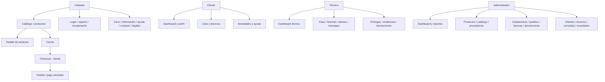

# MANUAL DE USUARIO

**Sistema:** NeoDomus  
**Documento:** Manual de usuario  
**Versión documental:** 1.1  
**Actualizado:** 30 de octubre de 2026  
**Dirigido a:** visitantes, clientes, técnicos y administradores

## Contenido

1. [Alcance](#1-alcance)
2. [Requisitos de conocimiento para operar el sistema](#2-requisitos-de-conocimiento-para-operar-el-sistema)
3. [Requisitos de hardware y software del equipo cliente](#3-requisitos-de-hardware-y-software-del-equipo-cliente)
4. [Información sobre la mesa de ayuda](#4-información-sobre-la-mesa-de-ayuda)
5. [Política de seguridad](#5-política-de-seguridad)
6. [Estructura del software](#6-estructura-del-software)
   - [Ingreso al sistema](#61-ingreso-al-sistema)
   - [Mapa de navegación](#62-mapa-de-navegación)
   - [Descripción de las funciones del sistema](#63-descripción-de-las-funciones-del-sistema)
   - [Descripción de los mensajes de error](#64-descripción-de-los-mensajes-de-error)
7. [Glosario](#7-glosario)
8. [Control del documento](#8-control-del-documento)

> **Nota sobre el alcance:** este manual aplica a las pantallas y flujos identificables en el repositorio. No se confirmó una URL pública activa. Las imágenes entregadas se usaron como guía de estructura, no como capturas de pantallas del producto.

## 1. Alcance

NeoDomus es una plataforma para consultar productos de domótica y gestionar pedidos, citas/instalaciones y actividades de servicio técnico. La aplicación web contempla visitantes, clientes, técnicos y administradores. La aplicación móvil presenta una experiencia pública/cliente y un área para técnicos.

El manual explica cómo orientarse en las secciones detectadas, cómo acceder y qué precauciones seguir. Una ruta o pantalla presente en el código no demuestra que todas sus operaciones estén conectadas o que el entorno esté publicado. El pago está configurado por defecto como simulador académico y no representa un cobro bancario real.

## 2. Requisitos de conocimiento para operar el sistema

No se encontró una certificación ni curso obligatorio para usuarios. Como orientación práctica, se recomienda que la persona pueda:

- Usar un navegador o abrir una aplicación móvil e interactuar con formularios y menús.
- Utilizar correo electrónico para verificar la cuenta o recuperar el acceso cuando el entorno tenga correo configurado.
- Seguir las instrucciones en pantalla y comunicar el mensaje/situación que aparece si una operación falla.
- Para clientes, conocer los datos de contacto y dirección que desea registrar.
- Para técnicos y administradores, recibir del responsable del proyecto la cuenta, el rol y las instrucciones operativas que correspondan.

Estos son conocimientos recomendados para la operación; el proyecto no documenta prerrequisitos de capacitación por perfil.

## 3. Requisitos de hardware y software del equipo cliente

### Equipo y conectividad

- Un equipo capaz de ejecutar un navegador web moderno o un teléfono compatible con la instalación móvil.
- Conexión de red que permita llegar a la dirección del frontend y a la API del entorno.
- Para la app móvil en dispositivo físico, acceso de red al servidor API configurado.

El repositorio no establece memoria, procesador, espacio libre, resolución mínima ni velocidad de conexión. No se inventan valores mínimos o recomendados.

### Software

| Cliente | Información verificable | Pendiente |
|---|---|---|
| Web | Interfaz React 18.3.1 y Vite 5.4.21 (`fe/package.json`) | No se encontró matriz oficial de navegadores/ versiones soportadas. |
| Móvil | Expo 57.0.22 y React Native 0.86.3 (`movil/package.json`) | La instalación final depende de cómo el equipo distribuya la aplicación y de las plataformas habilitadas. |
| API | Debe ser accesible desde el cliente | La URL la proporciona el responsable del entorno; no se encontró una dirección productiva confirmada. |

La versión de Node/Python para compilar es un requisito de desarrollo, no un requisito del equipo cliente que navega la web.

## 4. Información sobre la mesa de ayuda

No se encontró un correo, teléfono, horario ni responsable oficial de mesa de ayuda. Solicita estos datos al equipo que administra tu instalación de NeoDomus.

Al reportar un problema, incluye:

1. Tu perfil (visitante, cliente, técnico o administrador), sin compartir tu contraseña.
2. La sección y la acción que intentabas realizar.
3. Fecha y hora aproximada, y el dispositivo/navegador utilizado.
4. El texto del error, si aparece, y los pasos para reproducirlo.
5. Una captura de pantalla solo si no muestra contraseñas, códigos, tokens ni datos personales de otras personas.

No envíes contraseñas, códigos de verificación, tokens de sesión ni información de pago sensible.

## 5. Política de seguridad

No se encontró una política institucional publicada que el usuario deba aceptar para operar. Hasta que el equipo defina una política oficial, aplica estas medidas de cuidado:

- Usa una contraseña única y no la compartas.
- No compartas códigos de verificación o recuperación.
- Cierra sesión al terminar en un equipo compartido y protege el dispositivo.
- Mantén privados los datos personales y adjunta solo imágenes necesarias para el servicio.
- Confirma que estás usando la URL o instalación proporcionada por el responsable.
- Reporta actividad inesperada sin enviar credenciales.

El backend usa autenticación y controles por rol, pero los detalles de implementación pertenecen al manual técnico. Estas recomendaciones de usuario no deben confundirse con una certificación de seguridad del sistema.

## 6. Estructura del software

NeoDomus se presenta al usuario mediante dos clientes: una aplicación web (`fe/`) y una app móvil (`movil/`). Ambas se comunican con una API (`be/`) que administra operaciones y datos. El usuario no necesita instalar Python, Node.js, MySQL ni Docker para acceder a una instalación ya publicada. En una instalación local, el responsable del equipo debe iniciar primero esos servicios; consulta el [manual técnico](MANUAL_TECNICO.md).

La navegación cambia según el perfil. En la web hay rutas públicas y áreas de cliente, técnico y administrador. En móvil el código dispone de una experiencia pública/cliente y otra de técnico; no se identificó un panel de administración móvil equivalente.

### 6.1 Ingreso al sistema

La dirección de acceso debe ser entregada por quien administra el entorno. No se encontró URL de producción confirmada.

#### Crear cuenta e iniciar sesión en la web

1. Abre NeoDomus desde la dirección proporcionada.
2. Selecciona el acceso a la cuenta o registro que aparece en la interfaz.
3. Para registro de cliente, completa los datos requeridos por el formulario.
4. Si la instalación solicita verificar el correo, sigue el enlace o código que recibas. El envío depende de la configuración de correo del entorno.
5. Inicia sesión con tus credenciales. El backend también incluye inicio con Google, sujeto a que OAuth esté configurado.
6. Para cerrar sesión, utiliza la acción de salida en el menú de cuenta.

Las rutas web observadas incluyen `/login`, `/register`, `/verify-email`, `/forgot-password`, `/verify-code`, `/reset-password`, `/cambiar-password` y `/cambiar-password-obligatorio`.

#### Recuperar el acceso

1. Abre la opción de recuperación desde el acceso de cuenta.
2. Escribe el correo asociado a la cuenta y solicita el código.
3. Ingresa el código recibido y sigue las indicaciones para definir una nueva contraseña.
4. Si el mensaje no llega, revisa correo no deseado y contacta al responsable del entorno para confirmar que el envío esté habilitado.

En móvil existen pantallas para login, registro, verificación de correo y recuperación/cambio de contraseña.

### 6.2 Mapa de navegación

El siguiente mapa resume rutas del frontend registradas en `fe/src/App.tsx`. Las URL son rutas de la aplicación luego de abrir la dirección base. Los permisos se aplican según el rol y pueden requerir una sesión.

#### Rutas web por área

| Área | Rutas registradas | Perfil indicado por la configuración de rutas |
|---|---|---|
| Pública | `/`, `/productos`, `/producto/:id`, `/carrito`, `/home`, `/info`, `/ayuda`, `/terminos`, `/privacidad`, `/cookies`, `/contacto` | Visitante; algunas acciones requieren cuenta. |
| Cuenta | `/login`, `/register`, `/forgot-password`, `/verify-code`, `/reset-password`, `/verify-email` | Flujo de acceso. |
| Cliente | `/dashboard/cliente`, `/perfil`, `/cliente/tecnicos`, `/cliente/citas`, `/cliente/novedades`, `/cliente/ayuda`, `/cambiar-password` | Cliente autenticado. |
| Checkout | `/checkout` | Protegido para cliente. |
| Técnico | `/dashboard/tecnico`, `/perfil/tecnico`, `/tecnico/citas`, `/tecnico/historial`, `/tecnico/clientes`, `/tecnico/mensajes`, `/tecnico/calificaciones`, `/tecnico/entregas`, `/tecnico/devoluciones`, `/tecnico/novedades` | Técnico autenticado. |
| Administrador | `/dashboard/admin`, `/perfil/admin`, `/admin/notificaciones`, `/admin/productos`, `/admin/productos/nuevo`, `/admin/productos/:id`, `/admin/catalogo`, `/admin/tecnicos`, `/admin/instalaciones`, `/admin/pedidos`, `/admin/facturas`, `/admin/consultas`, `/admin/devoluciones`, `/admin/novedades`, `/admin/clientes`, `/admin/proveedores`, `/admin/reportes` | Administrador autenticado. |

La ruta `/notificaciones` también está registrada bajo el layout público, pero las operaciones disponibles dependen de la vista y del estado de sesión. Un visitante puede llegar a rutas desconocidas y la aplicación lo redirige a `/`.

En móvil la navegación se organiza en `app/(tabs)` y `app/(tecnico)`. Las pantallas concretas se listan en el código fuente; la app redirige al área técnica cuando reconoce el rol `tecnico`.

### 6.3 Descripción de las funciones del sistema

Las instrucciones siguientes explican la secuencia general visible en el producto. Los nombres de botones y campos pueden variar entre versiones; sigue el texto que muestre la pantalla. No se incluyen capturas porque en los adjuntos solo se proporcionaron diagramas de estructura, no pantallas reales de NeoDomus.

#### Consulta de productos

1. Abre el catálogo desde la página principal o `/productos`.
2. Recorre la lista y abre el producto para consultar su detalle.
3. Revisa la información, variantes y disponibilidad que se muestren.
4. Si deseas comprar, agrega el producto al carrito según los controles de esa pantalla.

#### Carrito y checkout

1. Abre `/carrito` y revisa los productos y cantidades.
2. Ajusta o elimina elementos usando las acciones disponibles.
3. Continúa al checkout. Debes ingresar como cliente; la ruta está protegida.
4. Completa la información solicitada y elige una alternativa de pago disponible en la pantalla.
5. Revisa el resumen antes de confirmar.

El backend declara `PAYMENT_PROVIDER=simulator` por defecto. Aunque se muestren nombres de medios de pago, no asumas que el flujo realiza un cargo real.

#### Perfil, citas y servicios del cliente

1. Ingresa con una cuenta de cliente.
2. Abre el perfil/dashboard y selecciona la sección disponible: datos de cuenta, citas/servicios, técnicos, pedidos, facturas, notificaciones o novedades.
3. Para solicitar o consultar una cita, utiliza las pantallas de citas y completa los datos que solicite el formulario.
4. Confirma el estado desde la sección correspondiente; si no aparece o no coincide, registra la situación para soporte.

El código contiene rutas para `/cliente/citas`, `/cliente/tecnicos`, `/perfil`, `/dashboard/cliente` y pantallas de catálogo/checkout. La disponibilidad de cada acción depende de la sesión y del backend.

#### Operación del técnico

1. Inicia sesión con un perfil técnico.
2. Abre el dashboard y consulta las citas/entregas que aparecen asignadas.
3. Selecciona el elemento para ver su detalle.
4. Usa las acciones habilitadas para actualizar el estado o adjuntar evidencia relacionada.
5. Revisa historial, clientes, mensajes, calificaciones, devoluciones y novedades en sus secciones.

No adjuntes imágenes ajenas al servicio ni datos personales innecesarios. No se documentan aquí cambios de estado concretos porque deben confirmarse en la operación del entorno.

#### Operación del administrador

La web incluye módulos administrativos de productos, catálogo, técnicos, instalaciones, pedidos, facturas, consultas, devoluciones, novedades, clientes, proveedores y reportes. Para operar:

1. Inicia sesión con el perfil de administrador que haya habilitado el responsable.
2. Abre el dashboard administrativo.
3. Entra al módulo que corresponda y localiza el registro usando sus filtros.
4. Revisa la información antes de guardar cualquier cambio.
5. Confirma que la pantalla indique el resultado esperado.

No se describe la creación de cuentas o roles como una acción disponible para todos los administradores; depende de los permisos y endpoints configurados.

### 6.4 Descripción de los mensajes de error

No se halló un catálogo central de mensajes de error del usuario. La tabla distingue situaciones probables de mensajes literales: los textos entre comillas no se inventan.

| Situación observada por el usuario | Qué puede significar | Acción recomendada |
|---|---|---|
| Credenciales rechazadas o acceso no completado | Datos incorrectos, cuenta aún no verificada o servicio de autenticación inaccesible | Revisa el correo, completa verificación si corresponde y solicita recuperación. Si persiste, contacta al administrador. |
| No llega el correo de verificación/recuperación | El envío SMTP/servicio de correo puede no estar configurado en ese entorno | Comprueba correo no deseado y pide al responsable revisar el servicio de correo. |
| Sesión expirada | El token ya no es válido o no pudo renovarse | Vuelve a iniciar sesión. No compartas el token al reportarlo. |
| Catálogo, pedido o cita no carga | Puede haber un problema de red, API o servicio de datos | Comprueba conectividad, vuelve a intentar y reporta la pantalla, hora y pasos. |
| Imagen no visible | El archivo o el servicio de almacenamiento puede no estar disponible | Intenta recargar y reporta el producto/registro afectado. |
| Pago en estado distinto al esperado | La configuración predeterminada simula el resultado | Revisa el estado mostrado y contacta al responsable; no lo tomes como comprobante de una transacción real. |

Los mensajes exactos y códigos técnicos deben consultarse en la respuesta del servicio o en los registros del entorno; no se presentan como mensajes literales en este manual.

## 7. Glosario

- **API:** servicio que comunica la aplicación web/móvil con el backend.
- **Cita/instalación:** solicitud programada de un servicio técnico.
- **Cliente:** persona usuaria con cuenta para gestionar compras y servicios.
- **Técnico:** perfil que atiende trabajo asignado.
- **Administrador:** perfil con acceso a módulos administrativos de la web.
- **Simulador de pago:** mecanismo de prueba que no procesa dinero real.
- **Sesión:** periodo durante el cual la cuenta permanece autenticada.

## 8. Control del documento

| Versión | Fecha | Descripción |
|---|---|---|
| 1.0 | 2026-10-30 | Primera versión de trabajo basada en rutas y configuración del repositorio. |
| 1.1 | 2026-10-30 | Reorganización con los componentes solicitados en el PDF y las imágenes de referencia. |

**Elaboró:** documentación del proyecto NeoDomus.  
**Aprobación institucional:** pendiente.  

Consulta el [manual técnico](MANUAL_TECNICO.md) y el [índice de documentación](docs/README.md).
