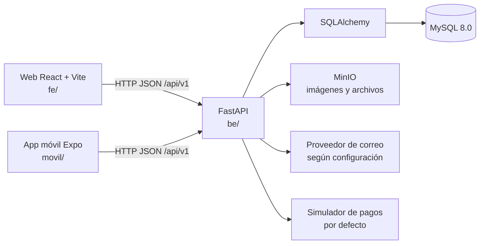

# Arquitectura del sistema

**Revisión documental:** 30 de octubre de 2026. Esta descripción se basa en la estructura y configuración visibles del repositorio; no prueba que exista un despliegue en producción.

## Vista general

NeoDomus está organizado como tres clientes/servicios principales: web React, aplicación móvil Expo y API FastAPI. La API usa SQLAlchemy para acceso relacional, Alembic para cambios de esquema, y servicios para pagos simulados, notificaciones y almacenamiento MinIO.

El diagrama representa dependencias configuradas en el repositorio. No implica que servicios externos estén configurados ni que un entorno de producción esté activo.

## Componentes

| Parte | Responsabilidad comprobable | Evidencia |
|---|---|---|
| API | Registra routers bajo `/api/v1`, middlewares, endpoints `/` y `/health`; inicia el scheduler durante el ciclo de vida | `be/app/main.py`, `be/app/routers/` |
| Persistencia | Engine SQLAlchemy configurado con `DATABASE_URL`; modelos ORM y migraciones Alembic | `be/app/database.py`, `be/app/models/`, `be/alembic/versions/` |
| Web | Rutas para visitante, cliente, técnico y administrador; cliente Axios configurable vía `VITE_API_URL` | `fe/src/App.tsx`, `fe/src/services/api.ts`, `fe/package.json` |
| Móvil | Navegación Expo Router; API configurable por `EXPO_PUBLIC_API_URL` o detección del host de Expo | `movil/app/_layout.tsx`, `movil/constants/api.ts` |
| Objetos | Cliente MinIO y bucket configurable para imágenes/archivos | `be/app/services/minio_service.py`, `be/app/config.py` |
| Contenedores | MySQL, API, MinIO y web en una red Compose | `docker-compose.yml` |

## Tecnologías configuradas

- Backend: `be/pyproject.toml` especifica Python `>=3.10`, FastAPI 0.115.0, Uvicorn 0.30.0, SQLAlchemy 2.0.30, Alembic 1.13.2. El Dockerfile usa Python 3.12.
- Web: `fe/package.json` declara React 18.3.1, Vite 5.4.21, TypeScript 5.9.3 y React Router DOM 7.18.0.
- Móvil: `movil/package.json` declara Expo 57.0.22, React Native 0.86.3, React 19.2.3 y Expo Router 57.0.21.
- Base de datos: el Compose declara `mysql:8.0`.
- Dependencias adicionales: MinIO, SMTP configurable, Google OAuth opcional y simulador de pago por defecto.

Las versiones anteriores describen los manifiestos en esta revisión, no una política de versiones futura.

## Flujo de una solicitud

1. El usuario interactúa con web o móvil.
2. El cliente envía solicitudes HTTP a la URL configurada, con prefijo `/api/v1`.
3. FastAPI despacha a los routers incluidos en `be/app/main.py`; los routers usan dependencias de base de datos, servicios y modelos.
4. SQLAlchemy accede a MySQL. Operaciones de archivos pueden delegar a MinIO; correo y pagos dependen de la configuración.
5. La API devuelve una respuesta al cliente.

## Roles y navegación web

`fe/src/App.tsx` define áreas públicas y rutas protegidas para `cliente`, `tecnico` y `administrador`. Las pantallas incluyen catálogo/carrito/checkout, perfil y citas de cliente, módulos de técnico, y gestión administrativa de productos, pedidos, facturas, instalaciones, devoluciones, clientes, proveedores y reportes. Esta lista describe rutas y pantallas; el estado funcional de cada acción debe verificarse en el endpoint correspondiente.

La app móvil separa `(tabs)` y `(tecnico)` y redirige según el rol restaurado en `movil/app/_layout.tsx`. No se encontró un área móvil de administración equivalente a la web.

## Datos y archivos

La base de datos evoluciona mediante migraciones en `be/alembic/versions/`; los modelos se encuentran en `be/app/models/`. Las migraciones, no un diagrama antiguo ni un listado de historias, determinan el esquema aplicado. El servicio MinIO fija lectura pública de objetos para el bucket configurado; no almacenar allí archivos privados sin revisar este diseño.

## Entorno local

`docker-compose.yml` define los puertos de host 3307 (MySQL), 8000 (API), 9000/9001 (MinIO) y 5173 (web). Compose configura el backend para ejecutar `alembic upgrade head` antes de Uvicorn. No se verificó un despliegue productivo.

## Fuentes relacionadas

- [Guía con Docker](../setup/con-docker.md) · [sin Docker](../setup/sin-docker.md)
- [Referencia API](api-endpoints.md)
- [Esquema de base de datos](database-schema.md)
- [Auditoría documental](../gestion/auditoria-documental.md)
