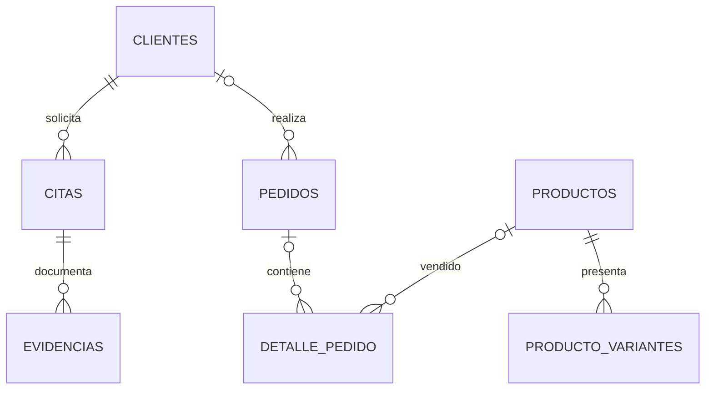

# Modelo de datos y esquema relacional

**Revisado:** 30 de octubre de 2026. Esta guía describe dónde obtener el esquema verdadero y resume las áreas de datos. No sustituye la inspección de la base de datos desplegada.

## Fuentes autoritativas

1. Migraciones de `be/alembic/versions/`, en orden de `revision`/`down_revision`. La migración más reciente visible en el checkout es `0060_stock_y_metros_decimal.py` (revisión `0060`, fecha indicada 2026-10-17).
2. Modelos ORM de `be/app/models/` para la estructura usada por la aplicación.
3. `scripts/init_db.sql` como script SQL adicional; compáralo con las migraciones antes de tratarlo como esquema equivalente.

No hay conexión a una base de datos productiva disponible en esta revisión. Las columnas y constraints desplegados pueden diferir si no se aplicaron las migraciones hasta `head`.

## Áreas representadas por los modelos

Los modelos presentes abarcan cuentas (`usuarios`, `clientes`, roles y tokens), operación técnica (`tecnicos`, especializaciones, ubicaciones, citas, historial y evidencias), catálogo (`productos`, variantes, categorías, proveedores), comercio (`pedidos`, detalle, pagos, facturas, devoluciones y reembolsos), además de notificaciones, novedades, consultas, tarifas y solicitudes. Ver archivos específicos en `be/app/models/`.

## Relaciones comprobables en declaraciones ORM

Algunas claves foráneas declaradas conectan clientes con citas/pedidos, técnicos con usuarios, productos con categorías/proveedores/variantes, pedidos con detalle/pagos/facturas y citas con productos/evidencias/calificaciones. Las relaciones y claves pueden evolucionar; para conocer tipos, nulabilidad, índices y acciones de borrado lee el modelo y su historial de migraciones.

El diagrama es una vista conceptual simplificada basada en claves foráneas visibles en los modelos; no incluye todas las tablas ni representa cardinalidades opcionales en todos los casos. No lo uses para generar una base de datos.

## Cambios recientes que requieren atención

La migración `0060` convierte existencias y cantidades por metros a tipos decimales. Algunos documentos anteriores afirman tipos enteros/flotantes o mencionan únicamente 48 migraciones; esos datos son históricos y deben prevalecer sobre ellos el estado actual de Alembic y los modelos.

## Diccionario

El documento [diccionario de datos](diccionario-de-datos.md) contiene descripciones por tabla, pero requiere reconciliación columna a columna con la revisión `0060` antes de usarlo como especificación exacta. Para una consulta fiel, revisa los modelos y migraciones actuales.
